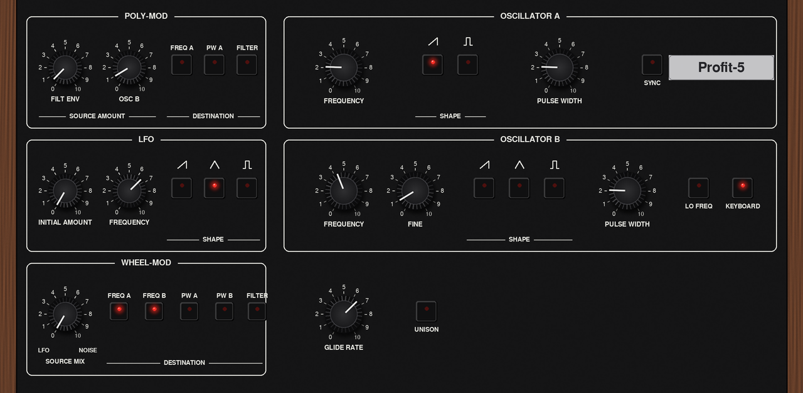
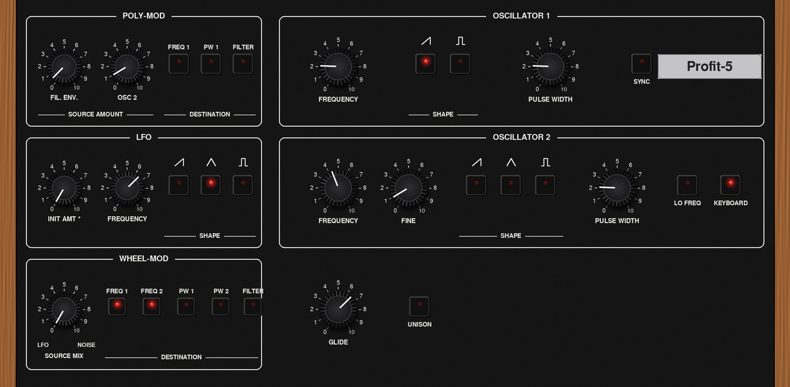

# Skin

`skin/make_skin.py` draws the 1280 x 628 skin from scratch, after the instrument's panel layout (2026-10-21, offline previews only;
not on a device yet). The process is mpc-vst-plugins' `.claude/skills/panel-skin/SKILL.md`.

    python3 skin/make_skin.py vst                 # Rev 4 look (default)
    P5_STYLE=rev2 python3 skin/make_skin.py vst   # the 1978-80 look

- **Materials are procedural:** black face, walnut cheeks, knurled black knobs with white pointers, aluminium tune and volume caps, square caps with red LEDs, and seven-segment glass.
  There's no photo, traced artwork or logo; the plate carries our own wordmark. The lettering is GNU FreeSans.
- **Tabs:** OSCILLATORS (Poly-Mod, LFO, Wheel-Mod, osc A/B, glide, unison), FILTER AMP (mixer, filter, amplifier, vintage, tune, volume, touch) and PROGRAMMER
  (program, voices, quality, rev). There are 7 Q-Link pages.
- **Controls:** knobs are 64-frame filmstrips over the printed 0-10 scale (-150 to +150 degrees). The program knob has one frame per program. Switches are off/on pairs.
  Each control is cut from its own tab, so its frames match the background exactly.
- **Styles:** `rev2` uses the early panel's names (OSCILLATOR 1/2, FREQ 1, PW 1, FIL. ENV., GLIDE) and lighter walnut. It keeps the controls the 1978 panel
  lacked, and the PROGRAMMER tab lists them. `rev4` uses the reissue's names and darker wood. Either style works with either sound (the REV switch).
- **Checks:** `gen_vst.py` builds it with no warnings. `tools/test_port.sh vst/vst.json` passes with it, built against mpc-vst-plugins PRs 486-489.

